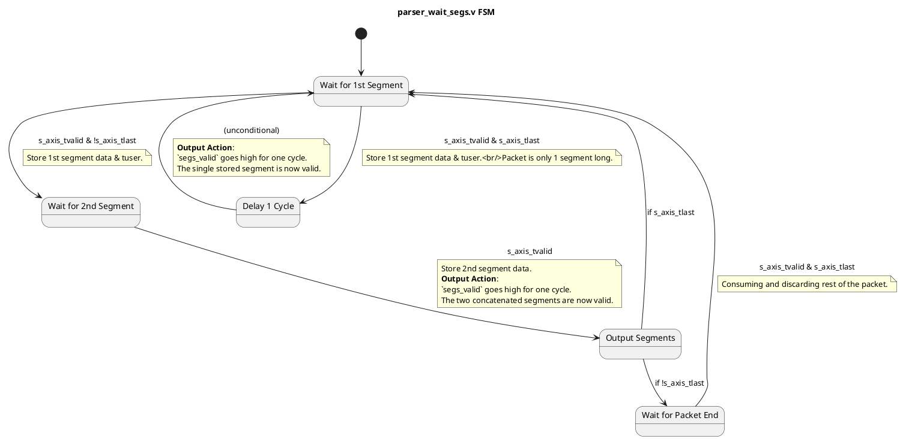

---
tags:
  - ysyx
status: Published
Publisher: CHEN
category: ysyx
---

### `parser_wait_segs.v` 真实功能：2-Segment 缓冲器

这个模块的真实功能是一个**固定大小的数据包头部缓冲器**。

它的核心目标非常明确：**从输入的AXI-Stream数据流中，捕获最多前2个数据分片（segments），将它们拼接成一个1024位的宽向量，然后作为一个整体在单个时钟周期内有效输出**。

这个模块**不进行任何协议解析**，也不关心PHV。它只是一个机械的、用于凑齐固定数据块的“暂存器”。它常用于需要一次性看到数据包前1024位才能做决策的场景。

---

### PlantUML 状态机图 (基于真实代码)

*注：`OUTPUT_SEGS` 在代码中不是一个显式状态，而是在 `WAIT_2ND_SEG` 状态满足条件时的一个瞬时动作，这里为了清晰地展示输出行为而将其画出。*

---

### 状态机详解

该模块包含一个4状态的状态机，用于处理不同长度的数据包。

#### 1. `WAIT_1ST_SEG` (等待第一个分片)
*   **职责**: 等待并捕获数据包的第一个512位分片。
*   **行为**:
    *   当一个有效分片 (`s_axis_tvalid`) 到达时，模块会：
        *   将其`tdata`存入1024位寄存器`tdata_segs`的**低512位**。
        *   将其`tuser`存入`tuser_1st`寄存器。
    *   **决策**:
        *   如果这个分片**同时也是最后一个** (`s_axis_tlast` 为真)，说明整个包只有1个分片。状态机跳转到 `WAIT_1CYCLE`。
        *   如果后面还有数据，状态机跳转到 `WAIT_2ND_SEG`。

#### 2. `WAIT_2ND_SEG` (等待第二个分片)
*   **职责**: 等待并捕获数据包的第二个512位分片。
*   **行为**:
    *   当第二个有效分片到达时，模块会：
        *   将其`tdata`存入1024位寄存器`tdata_segs`的**高512位**。
        *   **立即将 `segs_valid` 置为1**。此时，两个分片已经凑齐，拼接好的1024位数据和第一个分片的`tuser`可以被下游模块使用了。
    *   **决策**:
        *   如果这个分片**是最后一个** (`s_axis_tlast` 为真)，说明包正好是2个分片长。任务完成，状态机直接跳回 `WAIT_1ST_SEG`。
        *   如果后面还有数据（包长 > 2个分片），状态机跳转到 `WAIT_TILL_LAST`。

#### 3. `WAIT_1CYCLE` (单周期延迟)
*   **职责**: 这是一个用于处理单分片包的辅助状态。
*   **行为**:
    *   从 `WAIT_1ST_SEG` 跳转而来，无条件地等待一个时钟周期。
    *   在这个周期，它将 `segs_valid` 置为1，使得下游模块能采到那个单独的分片数据。
    *   下一个周期，无条件地跳回 `WAIT_1ST_SEG`。

#### 4. `WAIT_TILL_LAST` (等待包尾)
*   **职责**: 当数据包长度超过2个分片时，此状态负责**“快进”并丢弃**所有后续的分片，直到遇到包的结尾。
*   **行为**:
    *   它会一直停留在这个状态，忽略所有中间分片的数据。
    *   直到检测到 `s_axis_tvalid` 和 `s_axis_tlast` 同时为真，它才认为这个长包已经处理（忽略）完毕，然后跳回 `WAIT_1ST_SEG`，准备处理下一个新包。

### 总结

`parser_wait_segs.v` 是一个**2分片数据包头部聚合器**。

*   **输入**: 一个标准的AXI-Stream数据流。
*   **输出**:
    *   `tdata_segs`: 一个1024位的宽数据，由输入流的**前两个**512位分片拼接而成。
    *   `tuser_1st`: 第一个分片的`tuser`值。
    *   `segs_valid`: 一个单周期有效的脉冲信号，标志着`tdata_segs`和`tuser_1st`的数据是稳定且有效的。
*   **功能**:
    *   如果包长为1，它输出这1个分片。
    *   如果包长为2，它输出拼接后的2个分片。
    *   如果包长大于2，它仍然只输出前2个分片，并忽略掉包的其余部分。

