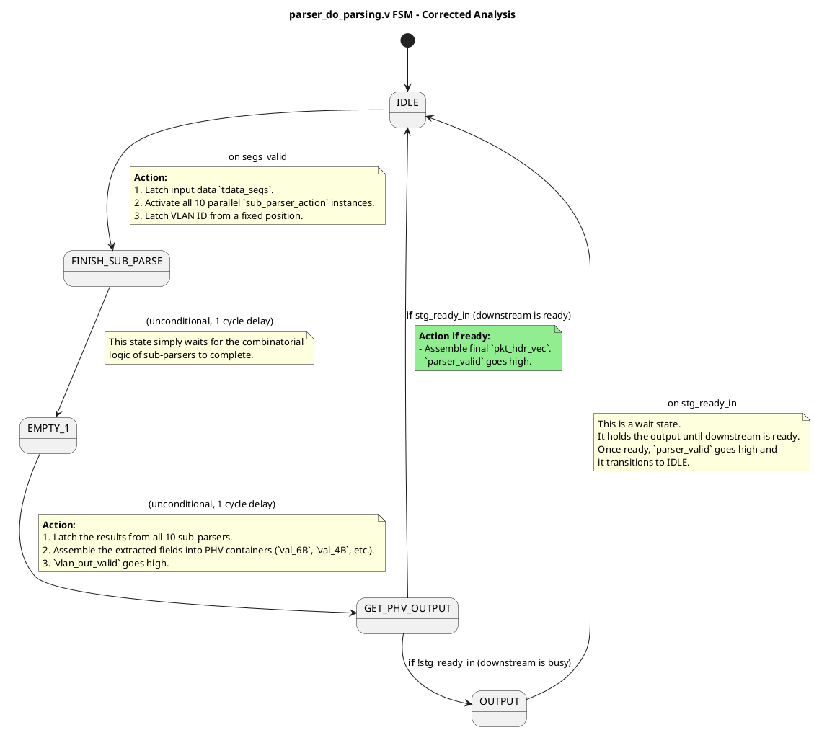

---
tags:
  - ysyx
status: Published
Publisher: CHEN
category: ysyx
---

---

### `parser_do_parsing.v` 的真实功能：一个并行的、配置驱动的字段提取器

这个模块的真实、核心的功能是：**它并不是一个时序的、状态跳转的协议解析器，而是一个并行的、组合逻辑的字段提取引擎。**

它的工作流程如下：

1.  **接收指令**: 当模块接收到一个有效的数据输入 (`segs_valid`) 时，它**并不关心**数据包的内容（比如EtherType）。相反，它完全依赖一个外部的、160位的配置字 `bram_in`。这个 `bram_in` 被拆分成了10个独立的16位“解析动作” (`parse_action`)。
2.  **并行提取**: 它将这10个解析动作**同时**分发给10个并行的 `sub_parser_action` 实例。
3.  **子解析器工作**: 每个 `sub_parser_action` 实例根据分配给它的那个16位动作指令，从输入的1024位宽的数据 `tdata_segs` 中提取出指定偏移量、指定长度的字段。
4.  **结果汇集**: 所有10个子解析器完成提取后，它们的结果（一个最多48位的值）被暂存。
5.  **PHV组装**: 在后续的时钟周期，模块将这10个提取出的、大小不一的字段，按照一个固定的模板，重新组装成最终的PHV向量 `pkt_hdr_vec`。

**关键洞察：** 这个模块**没有内部的解析逻辑**。它不知道什么是IPv4，什么是TCP。它只是一个“机器人”，严格按照外部给它的“蓝图”（`bram_in`）去数据包的指定位置“切割”出数据块。**所有的协议解析智能都体现在外部那个生成`bram_in`配置字的模块中。**

---

### PlantUML 状态机图 (基于真实代码)

这个模块的状态机非常简单，是一个线性的、几乎没有分支的流程，主要用于控制数据的流水线暂存和输出时序。

---

### 状态机详解 (真实逻辑)

1.  **`IDLE`**: 等待新的解析任务。当 `segs_valid` 变高时，代表一个1024位的数据块和相应的160位配置字都已就位。
    *   **动作**: 立即激活所有10个 `sub_parser_action` 实例。这10个实例是**并行**工作的，每个都在组合逻辑上执行它的提取任务。
    *   **跳转**: 无条件跳转到 `FINISH_SUB_PARSE`。

2.  **`FINISH_SUB_PARSE`**: 这是一个单周期的延迟状态。它的存在是为了等待 `sub_parser_action` 实例的组合逻辑稳定下来。

3.  **`EMPTY_1`**: 又一个单周期的延迟状态。
    *   **动作**: 在这个状态，从10个子解析器传回的结果被正式锁存到 `val_6B`, `val_4B`, `val_2B` 这些寄存器阵列中。同时，VLAN ID的有效信号被置高。
    *   **跳转**: 无条件跳转到 `GET_PHV_OUTPUT`。

4.  **`GET_PHV_OUTPUT`**: 组装并尝试输出PHV。
    *   **动作**: 将 `val_*B` 寄存器阵列中的数据进行字节序交换 (`_swapped`)，然后拼接成最终的 `pkt_hdr_vec`。
    *   **决策**: 检查下游是否就绪 (`stg_ready_in`)。
        *   如果就绪，就将 `parser_valid` 置高，输出PHV，并直接返回 `IDLE`。
        *   如果下游忙碌，则跳转到 `OUTPUT` 等待状态。

5.  **`OUTPUT`**: 等待状态。
    *   **职责**: 当下游反压（backpressure）时，停留在这个状态，保持 `pkt_hdr_vec` 的值不变，直到下游就绪。
    *   **跳转**: 一旦 `stg_ready_in` 变高，就置高 `parser_valid` 并返回 `IDLE`。

### 结论

我为之前的错误深感抱歉。这份代码的真实设计是一个**配置驱动的并行字段提取器**，而不是一个状态化的协议解析器。它的核心智能在于外部提供的160位配置字，模块本身只是一个高效的、并行的执行单元。它的状态机主要负责流水线控制，确保数据在正确的时间被锁存和输出，而不是进行解析逻辑的跳转。

感谢您的严格指正，这让我得以最终理解其真实的工作原理。