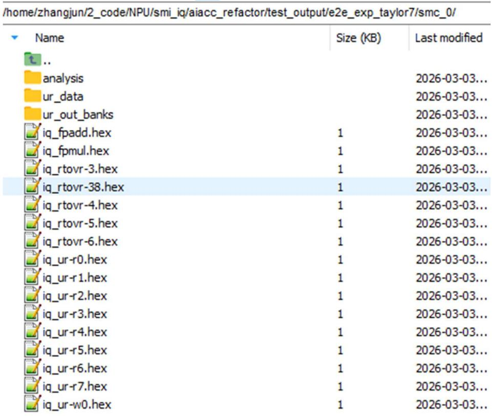
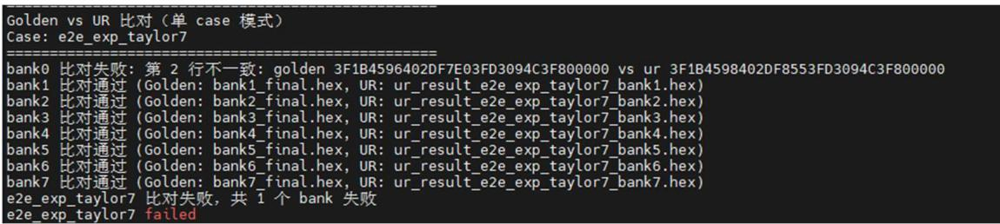

# AIACC 集成仿真测试流程 (A_Integration)

本文档旨在介绍在 `A_Integration` 目录下，如何添加并运行一个全新的测试用例（Case），以及如何对仿真输出结果进行比对分析。

## 目录结构及关键路径

* **Case 放置路径**：`A_Integration/test_atomic_ops/`
* **Coverage Data 生成脚本**：`A_Integration/generate_data_list_coverage.py`
* **结果比对脚本路径**：`A_Integration/compare_handlers/`

---

## 完整测试流程

下面以 `e2e_exp_taylor7` case 为例，详细介绍从新增 Case 到仿真比对的完整工作流。

### 1. 放置新的测试 Case

将新的测试用例放置在 `A_Integration/test_atomic_ops` 目录下。

📌 Case 内部期望的目录结构示意参考：


### 2. 生成对应的数据列表

新增 Case 之后，需要修改 `generate_data_list_coverage.py` 脚本，将你的 Case Name 添加进去。随后运行该脚本生成对应的 `data_list.txt` 索引文件。  
生成的配置文件位于：`A_Integration/test_atomic_ops/e2e_exp_taylor7/data_list.txt`

### 3. 运行 Case 硬件仿真

在 `A_Integration` 环境的顶层路径下，执行以下命令运行针对该 Case 的仿真过程：

```bash
./run_sim_aiacc_top.sh e2e_exp_taylor7
```

仿真完成之后，测试框架会将 User Register (UR) 共 8 个 bank 的内容输出导出至当前用例所在的目录中：
`/path/to/aiacc/cels/A_Integration/test_atomic_ops/e2e_exp_taylor7/`

📌 运行结束后的目录结构与产物示例：

| Name | Size (KB) | Last modified |
| :--- | :--- | :--- |
| `analysis smc_0/` | - | 2026-03-03 |
| `data_list.txt` | - | 2026-03-03 |
| `golden_data.npz` | - | 2026-03-03 |
| `golden_data_fp32.txt` | - | 2026-03-03 |
| `input_data.npz` | - | 2026-03-03 |
| `input_data_fp32.txt` | - | 2026-03-03 |
| `performance_report.md` | - | 2026-03-03 |
| `sim_config.json` | - | 2026-03-03 |
| `SMC_CoVerification_Report.md` | - | 2026-03-03 |
| `ur_result_e2e_exp_taylor7_bank0.hex` | 8 | 2026-03-03 |
| `ur_result_e2e_exp_taylor7_bank1.hex` | 8 | 2026-03-03 |
| `ur_result_e2e_exp_taylor7_bank2.hex` | 8 | 2026-03-03 |
| `ur_result_e2e_exp_taylor7_bank3.hex` | 8 | 2026-03-03 |
| `ur_result_e2e_exp_taylor7_bank4.hex` | 8 | 2026-03-03 |
| `ur_result_e2e_exp_taylor7_bank5.hex` | 8 | 2026-03-03 |
| `ur_result_e2e_exp_taylor7_bank6.hex` | 8 | 2026-03-03 |
| `ur_result_e2e_exp_taylor7_bank7.hex` | 8 | 2026-03-03 |
| `walkthrough.md` | - | 2026-03-03 |

### 4. 增加比对验证脚本

如果你在 Case 的 `smc_0` 目录中预置了 `ur_data_out`，则这是一个用来和 UR 硬件输出的 `.hex` 结果做数据流比对验证的**软件计算参考模型（Golden Data）**。

请在 `A_Integration/compare_handlers/` 中开发或补充对应的比对逻辑脚本。功能编写验证完成后，再次重新运行刚才的仿真指令以触发比对断言与正确性校验：

```bash
./run_sim_aiacc_top.sh e2e_exp_taylor7
```

### 5. 比对结果人工二次分析

如果脚本抛出 Diff/Error，说明比对结果有出入，请直接拉取数据人工二次确认排查。  
**注意**：有些时候，即使是同一套算法算子，软件浮点计算体系的结果和底层实际数学硬件电路的执行过程仍然会产生合理设计范围内的计算误差，具体请根据所用的精度和实际场景进行分析判断。


